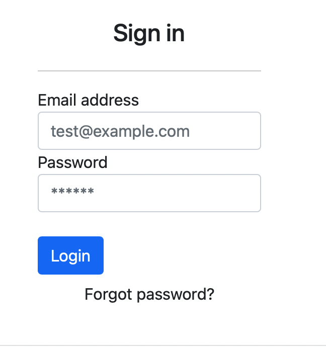
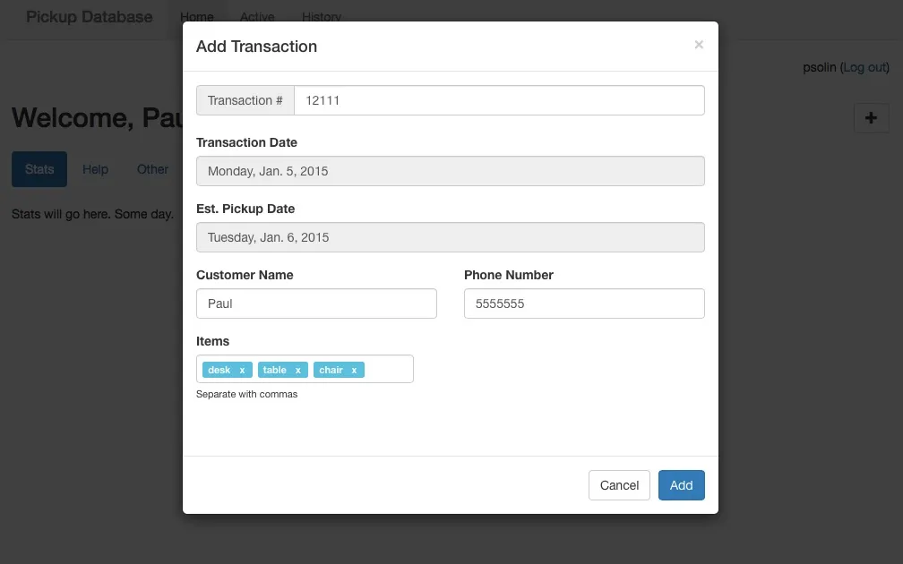

# Django Inventory Pickup Web App

A web app for tracking sold/held customer merchandise awaiting pickup. Built with Django and Bootstrap.

## Overview

Customers make a sale, creating a **transaction**. Each transaction contains **items** that are held by the store until the customer picks them up. Staff can track which items have been picked up, add notes, and flag overdue or forfeited transactions.

### Key Features

- Transaction and item-level pickup tracking
- Overdue detection based on estimated pickup dates
- Forfeit/reinstate transactions
- Notes with user attribution for audit trail
- Dashboard with stats breakdown
- Archived view for completed and forfeited transactions
- User authentication with profile management

## Tech Stack

- [Django 5.2 LTS](https://www.djangoproject.com) — backend framework
- [Bootstrap 5.3](https://getbootstrap.com) — UI framework
- [Bootstrap Icons](https://icons.getbootstrap.com) — icon set
- [jQuery 3.7](https://jquery.com) — AJAX operations
- [SQLite](https://sqlite.org) — database
- [Bootstrap Datepicker](https://github.com/uxsolutions/bootstrap-datepicker) — date selection
- [Bootstrap Tagsinput](https://github.com/timschlechter/bootstrap-tagsinput) — item entry
- [Inputmask](https://github.com/RobinHerbots/Inputmask) — phone number formatting
- [JSTable](https://github.com/nicktgn/jstable) — sortable/filterable tables

## Getting Started

**Requirements:** Python 3.9+

1. Clone the repository and `cd` into it.

2. Create a virtual environment and install dependencies:
   ```
   python -m venv venv
   source venv/bin/activate
   pip install -r requirements.txt
   ```

3. Run migrations:
   ```
   python manage.py migrate
   ```

4. Create a superuser:
   ```
   python manage.py createsuperuser
   ```

5. Start the development server:
   ```
   python manage.py runserver
   ```

### Environment Variables (optional)

| Variable | Default | Description |
|---|---|---|
| `DJANGO_SECRET_KEY` | auto-generated | Secret key for production |
| `DJANGO_DEBUG` | `True` | Set to `False` in production |
| `DJANGO_ALLOWED_HOSTS` | `localhost,127.0.0.1` | Comma-separated allowed hosts |

## Screenshots




## About

Originally built in 2015 as an internal tool proposal, now open-sourced as a portfolio project. Feel free to fork or file a bug report.

Visit [paulsolin.com](http://paulsolin.com) for more information.
